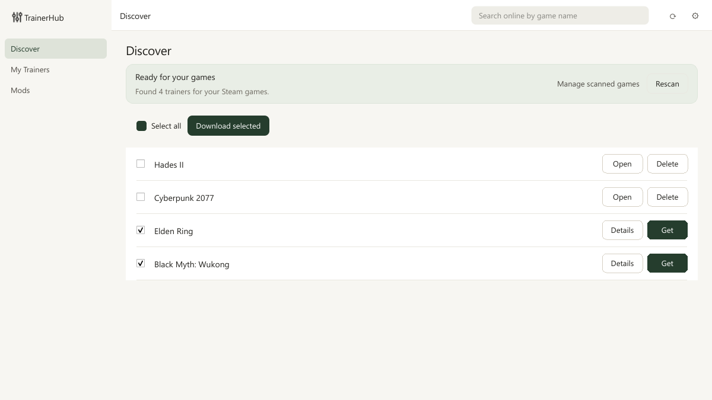
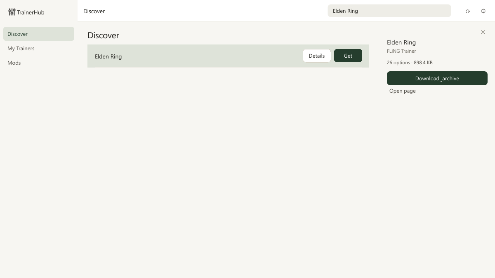
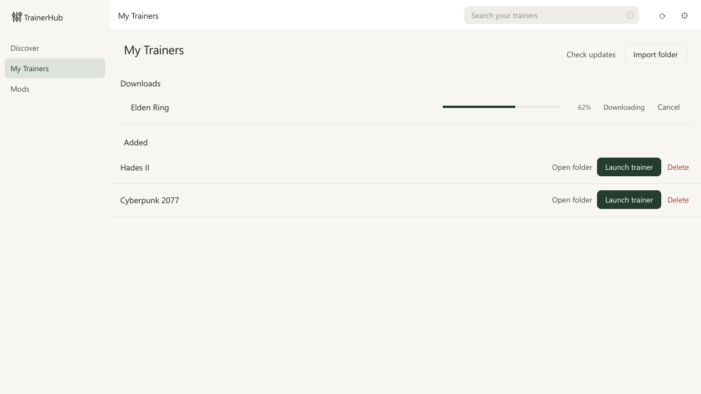
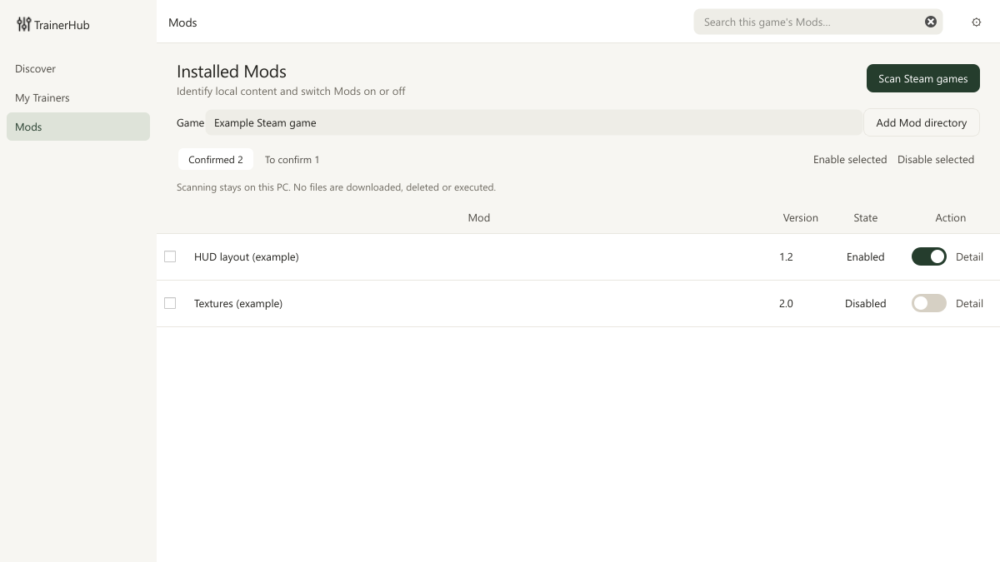

<div align="center">
  
  <h1>TrainerHub</h1>
  <p>Trainers and local Mod management for single-player games.</p>
  <p>Discover games · Organise trainers · Manage installed Mods</p>
  <p><a href="https://github.com/ew-wlee/TrainerHub/releases/latest"><strong>Download for Windows</strong></a></p>
  <p>Windows 10 / 11 · No installer, account or Python required</p>
  <p>English · <a href="README.zh-CN.md">简体中文</a></p>
</div>

---

TrainerHub brings finding trainers and managing installed Mods into one window. Search by game name or scan your local Steam installation for trainer recommendations. Downloads are extracted and filed in your trainer library; the separate **Mods** tab helps you identify and toggle content already installed in a game.



> Screenshots use isolated example data. Actual trainer availability depends on the source websites; the example Mods do not establish in-game compatibility.

## Get started

1. Download `TrainerHub.exe` from [Releases](https://github.com/ew-wlee/TrainerHub/releases/latest) and open it.
2. Choose where to keep your trainers and which sources to use.
3. Search in Discover, or select **Scan Steam games** to see recommendations for games on your computer.
4. Choose a trainer and download it. Find it later under **My Trainers**.
5. Already installed Mods yourself? Open **Mods**, scan your Steam games, and review the files found before enabling management.

The packaged app has no client dependencies to install. The default library is `%LOCALAPPDATA%\TrainerHub\Library`; you can change it in Settings.

## Find trainers for your games

### Start with your Steam library

Select **Scan Steam games** to read your local installation manifests and match installed games to available trainers. You can select several recommendations, rescan, or manage the games found by the scan.

The scan reads local installation information and does not modify game files. Recommendations match game names; **they do not establish compatibility with your current game version**. Check the source page before use.

### Search, inspect and download

Search the local catalogue by English or Chinese name, or pinyin. When you search, TrainerHub can also query FLiNG online. Select an entry to view the information available and start the download.



Direct downloads are extracted and filed automatically. Entries distributed through external services open their source pages instead. Search and download availability can change when third-party websites change or go offline.

### Keep everything together

**My Trainers** shows downloads in progress and items already in your library. Search added trainers, open their folders, launch them, or confirm removal. You can also import a local folder.



Downloaded trainers never run automatically. They start only when you select **Launch trainer** or **Open**. **Removing an entry deletes its folder and files**, including an imported local folder, so check that you no longer need it first.

## Manage Mods already in your games

### Scan and review

Open **Mods** and select **Scan Steam games**, then choose a game. TrainerHub looks for dedicated Mod folders and matching PAK / UTOC / UCAS file groups inside the installation. Available metadata supplies names and versions; otherwise the directory or file name is shown, with unknown versions left as **Unknown**.



### Confirm what belongs to a Mod

**Confirmed** items have known file boundaries; **To confirm** items need review. Open a candidate to check its location and included files. Only confirm independently owned content that loads through file presence. If a game uses another dedicated subdirectory, select **Add Mod directory** and save its folder or package-group rule locally.

Detection covers the directories checked, not every way a game can be modified. **No detection rule does not mean no Mods.** Unrecorded replacements of original files, user-directory or Workshop-managed content, and items requiring configuration synchronization or script merging are outside this version's management scope. Detected links or other managers' deployment records keep affected content read-only.

### Switch off and restore

Use a Mod's switch, or select several items and choose **Enable selected** or **Disable selected**. A switch updates after the file operation succeeds. Disabling moves the recorded content outside the game's loading directory; enabling restores its original location. Running games, externally changed files and existing restore targets stop the operation instead of overwriting content.

Keep TrainerHub's configuration data and the Steam library's `.trainerhub-mods` storage together: they record how to restore disabled Mods. Interrupted operations are checked for recovery when the Mods page opens or a scan starts. **Enabled describes file presence in a confirmed loading location, not verified in-game effects or compatibility.** TrainerHub does not download, install or delete Mods in this release. File-operation and UI tests are automated; real-game Mod effects still need manual verification.

## Common questions

**What if I can't find a game?** Try its English or Chinese name, or an alias. Games that cannot be matched reliably by the Steam scan can still be searched manually; availability depends on third-party sources.

**How do I check version compatibility?** Search and recommendations help you find an entry, but do not verify compatibility with your current game version. Open the source page and check the supported versions.

**Is my Steam library uploaded?** Scanning and recommendations run locally and do not upload your game list in bulk. An online search may send your query and English aliases used for follow-up searches to FLiNG.

**Why is a Mod missing or its switch unavailable?** Check **To confirm** and the item's explanation. You can add an independent Mod directory inside the game installation. Content with unclear ownership, shared links or unsupported loading mechanisms stays read-only; a full-disk search or Nexus account cannot resolve that file ownership automatically.

## Run from source

Install Python 3.12 and [uv](https://docs.astral.sh/uv/):

```bash
uv sync
uv run trainerhub
```

Run tests or build the Windows executable:

```bash
uv sync --extra dev
uv run pytest
uv run pyinstaller packaging/trainerhub.spec --noconfirm
```

## About the sources

TrainerHub indexes public information from third-party websites and manages downloads. It does not host, mirror or redistribute trainer files, is not affiliated with the sources or game publishers, and does not provide anti-cheat bypasses. Trainers are intended for offline single-player games; evaluate third-party executable files before running them.

The project is released under the [MIT license](LICENSE). See the [architecture notes](docs/architecture.md) for implementation details.
