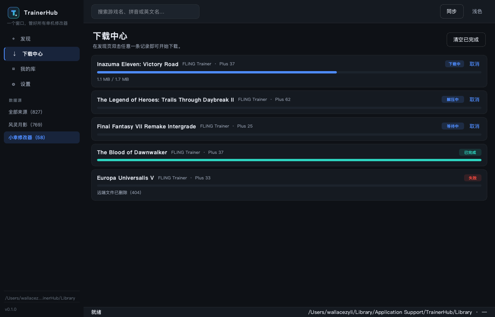
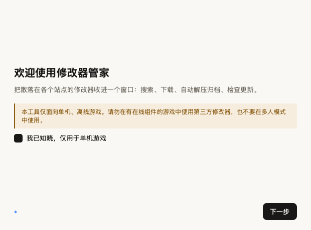
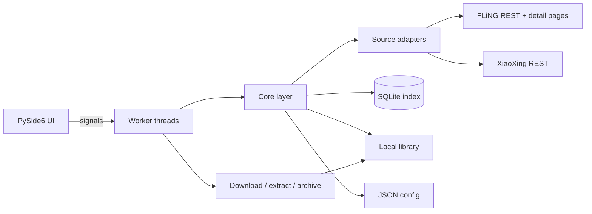

<div align="center">


# TrainerHub

**English** | [简体中文](README.zh-CN.md)

One desktop window for finding, downloading and keeping single-player game trainers up to date.

[](https://github.com/ew-wlee/TrainerHub/releases/latest)
[](https://github.com/ew-wlee/TrainerHub/releases)
[](LICENSE)
[](#-download)
[](pyproject.toml)

### [⬇ Download TrainerHub.exe for Windows](https://github.com/ew-wlee/TrainerHub/releases/latest)

Double-click, no Python required. macOS and Linux users can run from source.

[Product page](https://ew-wlee.github.io/TrainerHub/) · [Architecture notes](docs/architecture.md)

</div>


---

## Why

Trainers are scattered across a handful of sites, each with its own layout, its own
file host and its own idea of what "version" means. In practice you end up with
twelve browser tabs, a Downloads folder of `Trainer.v2.FINAL(1).zip`, and no idea
which build actually matches the game you patched last week.

TrainerHub collapses that into one window: **search → inspect → download →
auto-extract → archive → update**.

## What it does

| | Capability |
| --- | --- |
| 🔍 | **Bilingual instant search** — Chinese, English, full pinyin or pinyin initials (`hshwk` finds 黑神话：悟空). Local index, no round trip per keystroke. |
| 🧩 | **Multi-source aggregation** — FLiNG Trainer (direct download) and 小幸修改器 (index + jump), plus local folder import and a custom JSON source you can point anywhere. |
| ⬇️ | **One-click pipeline** — resolve the real file URL, stream with progress, sniff the container (zip / 7z / raw exe), extract safely, tag the version, archive to `source/game/version/`. |
| 🗂 | **Library you can reason about** — every install gets a `manifest.json` with its origin, version and page URL, so "where did this exe come from" is always answerable. |
| 🔄 | **Version awareness** — the catalogue records what the site currently ships; the library records what you have. Differences surface as an update badge. |
| 🛡 | **Safety rails** — zip-slip protection, size caps, nothing is ever auto-executed, and on Windows an opt-in, scoped Defender exclusion helper. |
| 🌓 | **Dark / light themes, 中文 / English UI**, custom library path, concurrent download control. |

## Screenshots

| Discover | Detail |
| --- | --- |
|  |  |

| Downloads | Library |
| --- | --- |
|  |  |

| Settings | First-run wizard |
| --- | --- |
|  |  |

## Data sources

| Source | Site | Delivery | In TrainerHub |
| --- | --- | --- | --- |
| FLiNG Trainer | <https://flingtrainer.com> | Direct file | One-click download |
| 小幸修改器 (XiaoXing) | <https://www.xiaoxingjie.com> | 百度网盘 / MediaFire | Indexed, opens the page |
| Custom JSON | any URL you host | Whatever you point at | `.json` index adapter |
| Local import | your own folders | Already on disk | Registered into the library |

TrainerHub stores **metadata only**. It never hosts, mirrors or redistributes trainer
binaries — downloads go straight from the original site to your disk.

## How it works



- **`core/`** is pure Python — no Qt — so search, parsing, archiving and the
  download pipeline are unit-tested without a display.
- **`workers/`** wraps the blocking parts in `QThread`s; the UI only reacts to signals.
- **`ui/`** is a thin presentation layer with a single token table shared by the
  stylesheet and the hand-painted list delegate.

Two-phase sync keeps it fast: the list pass is ~8 REST pages (≈5 s for 800+ entries),
while detail pages are fetched lazily and cached in SQLite.

More detail: [`docs/architecture.md`](docs/architecture.md) · product notes:
[`docs/product.md`](docs/product.md) · plan: [`docs/roadmap.md`](docs/roadmap.md).

## Download

**Windows (recommended).** Grab `TrainerHub.exe` from
[Releases](https://github.com/ew-wlee/TrainerHub/releases/latest) and double-click it.
It is a single self-contained file — no Python, no installer, no admin rights.

> SmartScreen may warn about an unsigned executable. Choose *More info → Run anyway*,
> or build it yourself with the script below.

## Run from source

```bash
git clone https://github.com/ew-wlee/TrainerHub.git
cd TrainerHub
uv sync --extra dev
uv run trainerhub
```

Without `uv`: `python -m venv .venv && .venv/bin/pip install -e ".[dev]" && .venv/bin/python -m trainerhub`.

### Build the executable

```powershell
# Windows
pwsh scripts/build_windows.ps1
```

```bash
# macOS / Linux (smoke-tests the same PyInstaller recipe)
./scripts/build_macos.sh
```

Windows builds are also produced automatically by GitHub Actions on every `v*` tag.

### Tests

```bash
uv run pytest -q     # 41 tests, no network required
uv run ruff check .
```

## Roadmap

- [ ] Cheat Engine table (.CT) source with a dedicated viewer
- [ ] Community submission flow with a review queue
- [ ] Per-game "installed / outdated / missing" dashboard
- [ ] Portable mode (config next to the executable)

## Legal

TrainerHub is an **index and download manager**, not a cheat provider.

- For **single-player, offline** games only. Using trainers in games with online
  components may violate their terms of service.
- **No anti-cheat bypass** is provided, documented or supported — by design.
- Trainer binaries belong to their respective authors. TrainerHub claims no rights
  over them and makes no warranty about their safety.
- Game and product names are trademarks of their respective owners.

See [`NOTICE.md`](NOTICE.md) for source attribution and the full disclaimer.

## License

[MIT](LICENSE) © 2026 ew-wlee

Product direction inspired by [Game Cheats Manager](https://github.com/dyang886/Game-Cheats-Manager)
(GPL-3.0). This repository is an independent rewrite — no source code, binaries,
fonts or icons were copied from it.
