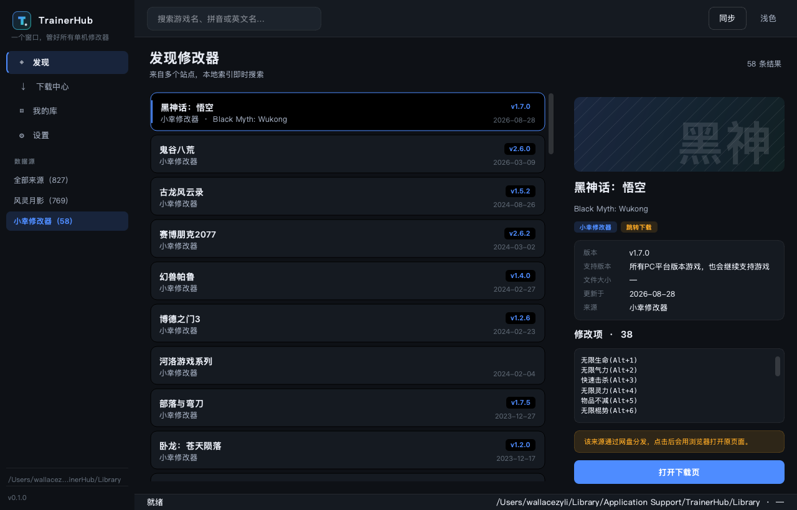
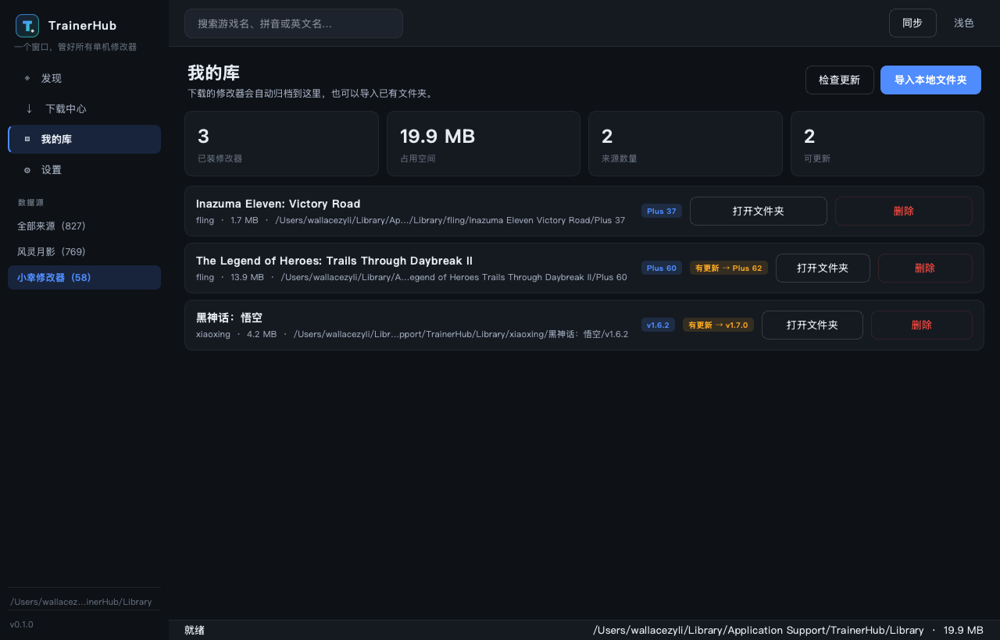
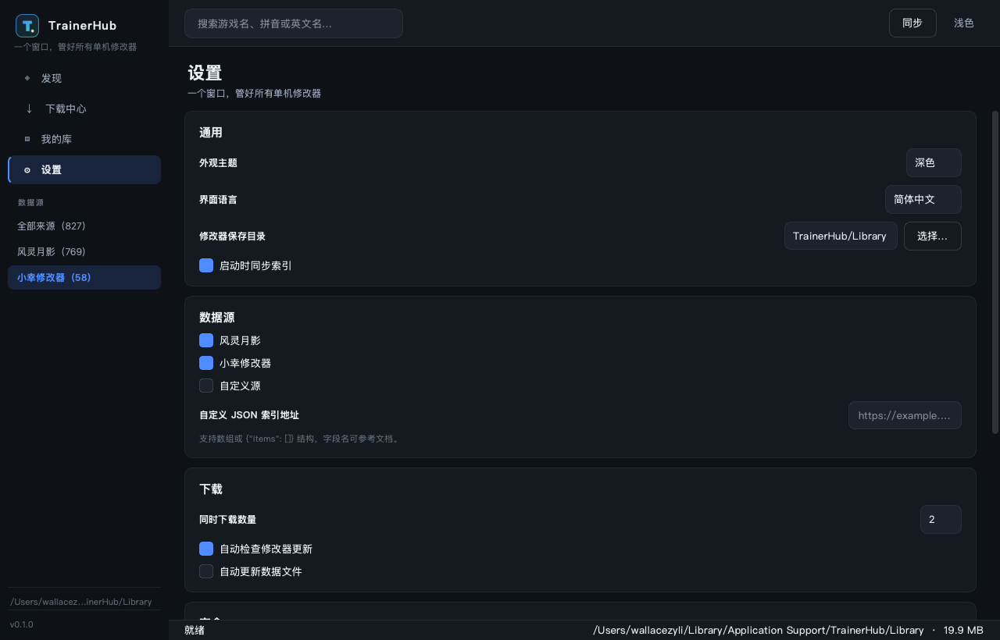
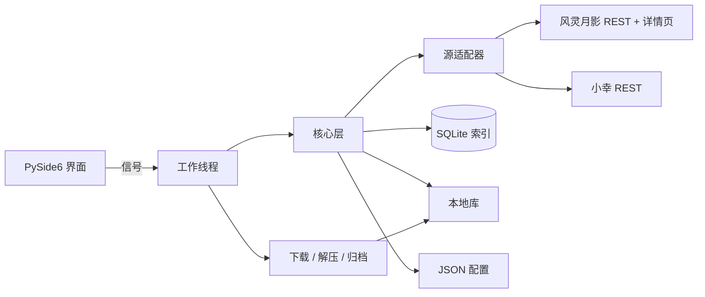

<div align="center">


# TrainerHub 修改器管家

[English](README.md) | **简体中文**

一个窗口搞定单机游戏修改器的搜索、下载与版本管理。

[](https://github.com/ew-wlee/TrainerHub/releases/latest)
[](https://github.com/ew-wlee/TrainerHub/releases)
[](LICENSE)
[](#-下载)
[](pyproject.toml)

### [⬇ 下载 Windows 版 TrainerHub.exe](https://github.com/ew-wlee/TrainerHub/releases/latest)

双击即用，不需要装 Python。macOS / Linux 可从源码运行。

</div>


---

## 为什么做这个

修改器散落在好几个站点，每个站点的排版、网盘、版本号写法都不一样。实际使用中
往往是：开十几个标签页、下载文件夹里堆着 `修改器v2.最终版(1).zip`，而游戏上周
更新过之后，已经分不清哪个文件还能用。

TrainerHub 把这件事收进一个窗口：**搜索 → 看详情 → 下载 → 自动解压 → 归档 → 检查更新**。

## 功能

| | 能力 |
| --- | --- |
| 🔍 | **中英双语即时搜索** —— 中文名、英文名、全拼、拼音首字母（`hshwk` 能搜到黑神话：悟空）。索引在本地，敲键盘不用等网络。 |
| 🧩 | **多源聚合** —— 风灵月影（可直下）、小幸修改器（索引 + 跳转），外加本地文件夹导入和可自定义的 JSON 源。 |
| ⬇️ | **一键下载链路** —— 解析真实文件地址、流式进度、按魔数识别容器（zip / 7z / 裸 exe）、安全解压、打版本标签，归档到 `来源/游戏/版本/`。 |
| 🗂 | **说得清楚的本地库** —— 每次安装都写 `manifest.json`，记录来源、版本和原页面地址，"这个 exe 哪来的"永远有答案。 |
| 🔄 | **版本感知** —— 索引记录站点当前发布的版本，本地库记录你手上的版本，有差异就用角标提示。 |
| 🛡 | **安全边界** —— zip-slip 防护、体积上限、**任何下载物都不会被自动执行**；Windows 下提供限定目录、需要二次确认的 Defender 排除项助手。 |
| 🌓 | **明暗主题、中英界面**，可自定义保存目录、限制同时下载数量。 |

## 界面

| 发现 | 详情 |
| --- | --- |
|  |  |

| 下载中心 | 我的库 |
| --- | --- |
|  |  |

| 设置 | 首次启动向导 |
| --- | --- |
|  |  |

## 数据来源

| 来源 | 站点 | 分发方式 | 在本程序里 |
| --- | --- | --- | --- |
| 风灵月影 FLiNG | <https://flingtrainer.com> | 站内直链 | 一键下载 |
| 小幸修改器 | <https://www.xiaoxingjie.com> | 百度网盘 / MediaFire | 建立索引，点击打开原页 |
| 自定义 JSON 源 | 你托管的任意地址 | 取决于你的索引 | JSON 索引适配器 |
| 本地导入 | 你自己的文件夹 | 已在本地 | 注册进库 |

TrainerHub **只存元数据**，不托管、不镜像、不再分发任何修改器文件；下载是从原始站点
直连到你的硬盘。

## 工作方式



- **`core/`** 是纯 Python（不依赖 Qt），搜索、解析、解压、下载管道都能脱离界面做单测。
- **`workers/`** 用 `QThread` 包住阻塞操作，界面只负责响应信号。
- **`ui/`** 是薄展示层，样式表与自绘列表共用同一套设计 token。

同步分两段：列表阶段约 8 次 REST 请求（800+ 条 ≈ 5 秒），详情页按需懒加载并缓存进 SQLite。

更多细节：[`docs/architecture.md`](docs/architecture.md) · 产品说明：
[`docs/product.md`](docs/product.md) · 规划：[`docs/roadmap.md`](docs/roadmap.md)。

## 下载

**Windows（推荐）**：到 [Releases](https://github.com/ew-wlee/TrainerHub/releases/latest)
下载 `TrainerHub.exe`，双击即可。单文件、无需 Python、无需安装、无需管理员权限。

> 未签名程序可能触发 SmartScreen 提示，选择「更多信息 → 仍要运行」即可；也可以用下面的脚本自行构建。

## 从源码运行

```bash
git clone https://github.com/ew-wlee/TrainerHub.git
cd TrainerHub
uv sync --extra dev
uv run trainerhub
```

没有 `uv`：`python -m venv .venv && .venv/bin/pip install -e ".[dev]" && .venv/bin/python -m trainerhub`。

### 自行打包

```powershell
# Windows
pwsh scripts/build_windows.ps1
```

```bash
# macOS / Linux（用于验证同一份 PyInstaller 配方）
./scripts/build_macos.sh
```

每次打 `v*` 标签时，GitHub Actions 也会自动构建 Windows 版本。

### 测试

```bash
uv run pytest -q     # 41 个用例，全部离线
uv run ruff check .
```

## 后续规划

- [ ] 支持 Cheat Engine 脚本表（.CT）并提供专用查看器
- [ ] 社区投稿与人工审核队列
- [ ] 按游戏的「已安装 / 可更新 / 缺失」面板
- [ ] 便携模式（配置写在 exe 同目录）

## 合规说明

TrainerHub 是**索引与下载管理器**，不是修改器提供方。

- 仅限**单人、离线**游戏使用；在含在线组件的游戏中使用可能违反其服务条款。
- **不提供、不记录、不支持**任何反作弊绕过手段——这是有意的产品边界。
- 修改器版权归各自作者所有；本项目不对其安全性作任何担保。
- 文中出现的游戏名、产品名均为其各自所有者的商标。

来源归属与完整免责声明见 [`NOTICE.md`](NOTICE.md)。

## 许可

[MIT](LICENSE) © 2026 ew-wlee

产品方向受 [Game Cheats Manager](https://github.com/dyang886/Game-Cheats-Manager)（GPL-3.0）
启发。本仓库为独立重写，未复制其任何源码、二进制、字体或图标资源。
