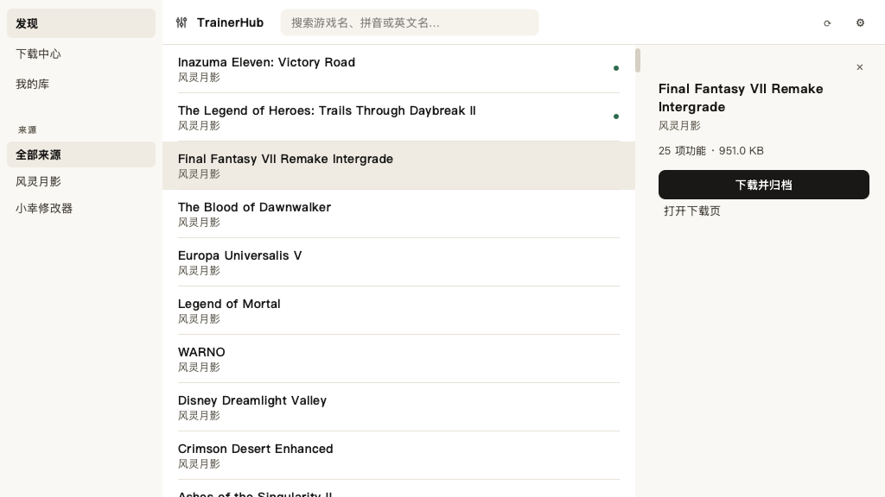

<div align="center">


# TrainerHub 修改器管家

[English](README.md) | **简体中文**

找到修改器，装好，去玩。

一个只管单机游戏修改器的小工具：搜索、下载、解压、归档。

[](https://github.com/ew-wlee/TrainerHub/releases/latest)
[](LICENSE)
[](#安装)

### [下载 Windows 版 TrainerHub.exe](https://github.com/ew-wlee/TrainerHub/releases/latest)

60 MB · 免安装 · 不需要账号 · 不需要 Python

</div>



## 它做什么

- **只搜一次。** 风灵月影和小幸修改器合并成一个列表，支持中文名、英文名、拼音全拼和首字母。
- **一键装好。** 下载后校验、解压，按游戏名归档到独立文件夹。
- **库里找得到。** 已安装的修改器按游戏列出，打开目录、运行或删除。

## 安装

下载上面的 `TrainerHub.exe`，双击即可。Windows 10 / 11，不需要安装其他东西。

修改器默认存放在 `%USERPROFILE%\TrainerHub\Library`，可以在设置里改。

## 从源码运行

```bash
# Python 3.12+ 与 uv
uv sync
uv run trainerhub
```

自己打包 exe：

```bash
uv sync --extra dev
uv run pyinstaller packaging/trainerhub.spec --noconfirm
# → dist/TrainerHub.exe
```

## 说明

修改器只用于单机离线游戏。在联机对局中使用可能导致账号被封。

TrainerHub 只索引来源站公开的元数据并调度下载，不内置、不镜像、不再分发任何修改器文件，也不提供反作弊绕过手段；与风灵月影、小幸修改器及各游戏发行商均无关联。

MIT 许可。架构说明在 [`docs/architecture.md`](docs/architecture.md)。
