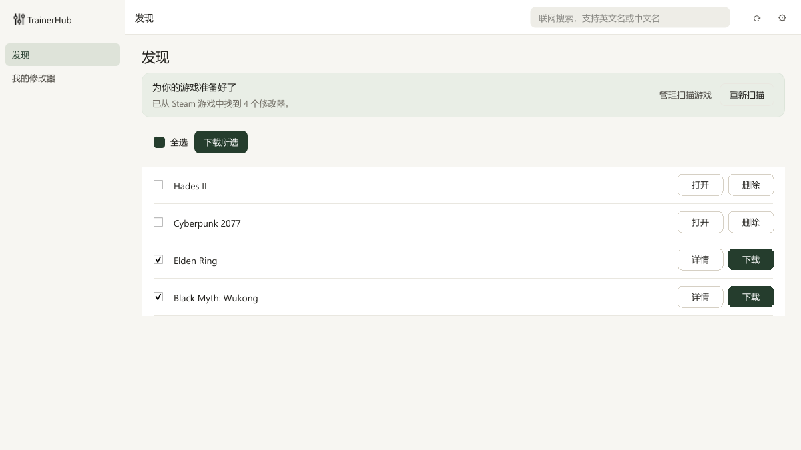
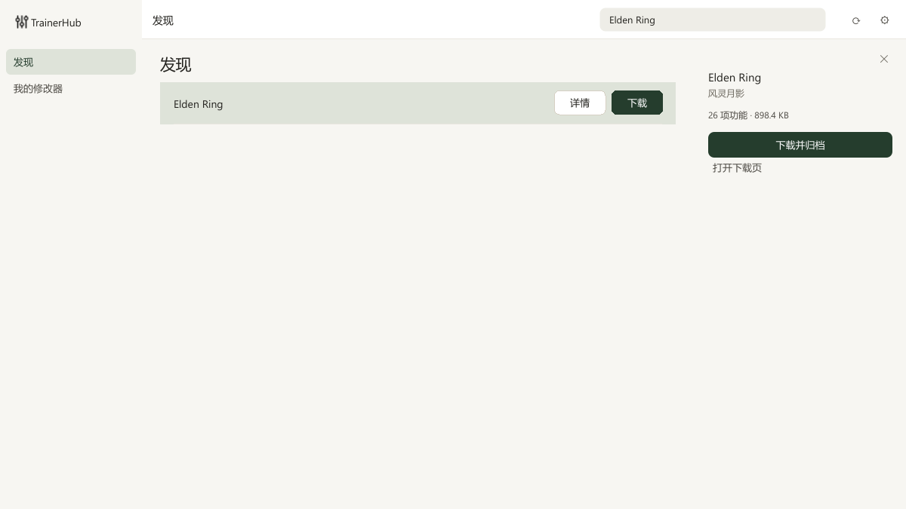
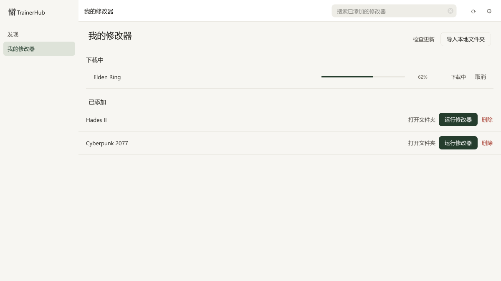

<div align="center">
  
  <h1>TrainerHub 修改器管家</h1>
  <p>给单机游戏玩家的修改器管理工具。</p>
  <p>发现游戏 · 下载归档 · 随时打开</p>
  <p><a href="https://github.com/ew-wlee/TrainerHub/releases/latest"><strong>下载 Windows 版</strong></a></p>
  <p>Windows 10 / 11 · 免安装 · 无需账号或 Python</p>
  <p><a href="README.md">English</a> · 简体中文</p>
</div>

---

TrainerHub 把查找和整理修改器的过程放在一个窗口里。输入游戏名，或扫描本地 Steam 安装清单，就能查看可用的修改器；下载后，文件会自动解压并放入你的修改器库。



> 界面截图使用示例数据；搜索结果和修改器的可用性以实际来源为准。

## 开始使用

1. 从 [Releases](https://github.com/ew-wlee/TrainerHub/releases/latest) 下载 `TrainerHub.exe`，双击打开。
2. 首次使用时，选择修改器保存目录和想使用的数据源。
3. 在「发现」中搜索游戏，或点击「扫描 Steam 游戏」查看本机游戏的推荐。
4. 选择修改器并下载；完成后，在「我的修改器」里打开或管理。

无需安装客户端依赖。默认的修改器库位于 `%LOCALAPPDATA%\TrainerHub\Library`，也可以在设置中更改。

## 发现适合你游戏的修改器

### 从 Steam 游戏开始

点击「扫描 Steam 游戏」，TrainerHub 会读取本机安装清单，尝试为已安装的游戏匹配修改器。列表支持选择多个推荐并下载，也可以重新扫描或管理扫描到的游戏。

扫描只读取 Steam 的本地安装信息，不会修改游戏文件。推荐基于游戏名称匹配，**不代表修改器一定兼容当前游戏版本**；使用前请查看来源页面的信息。

### 搜索、查看、下载

输入中文名、英文名或拼音，查找本地目录中的游戏；主动搜索时，程序也会向风灵月影联网补充查询。选中条目可以查看已取得的信息，并开始下载。



支持直链的修改器会在下载后自动解压、归档；需要网盘等外部方式下载的条目会打开来源页面。第三方网站调整或不可用时，搜索和下载可能受到影响。

### 在一个地方管理

「我的修改器」展示下载进度和已归档的条目。你可以搜索已添加的修改器、打开文件夹、运行修改器，或确认后删除。也可以导入本地文件夹。



下载完成后程序不会自动运行修改器；点击「运行修改器」或「打开」才会启动。**删除条目会删除对应的文件夹和其中的文件**，包括导入的本地文件夹，请先确认不再需要。

## 常见问题

**没有找到我的游戏怎么办？** 试试游戏的中文名、英文名或别名。Steam 扫描无法可靠匹配的游戏，也可以手动搜索；修改器是否存在取决于第三方来源。

**如何确认版本兼容？** 推荐和搜索只负责帮你找到条目，不会判断当前游戏版本是否兼容。打开来源页面，核对修改器支持的游戏版本。

**程序会上传我的 Steam 游戏列表吗？** 扫描和推荐在本机进行，不会批量上传游戏列表。主动联网搜索时，搜索词及用于补搜的英文名称可能会发送给风灵月影。

## 从源码运行

需要 Python 3.12 和 [uv](https://docs.astral.sh/uv/)：

```bash
uv sync
uv run trainerhub
```

运行测试，或构建 Windows 程序：

```bash
uv sync --extra dev
uv run pytest
uv run pyinstaller packaging/trainerhub.spec --noconfirm
```

## 关于数据来源

TrainerHub 索引第三方网站公开的信息并调度下载，不托管、镜像或再分发修改器文件；与风灵月影、小幸修改器及游戏发行商没有关联，也不提供反作弊绕过功能。修改器面向单机离线游戏，运行第三方程序前请自行判断风险。

项目以 [MIT 许可](LICENSE)发布。更多实现细节见 [架构说明](docs/architecture.md)。
